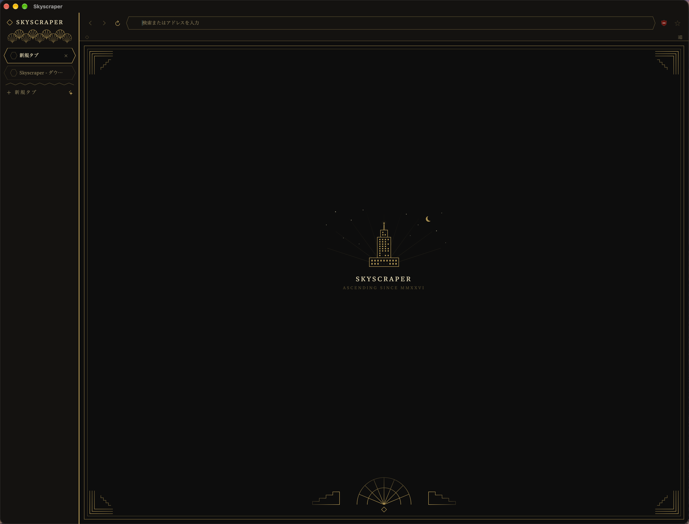

<div align="center">

# SKYSCRAPER

**ASCENDING SINCE MMXXVI**

macOS のための、アール・デコのウェブブラウザです。


[](https://github.com/inugamine/Skyscraper/releases/latest)


[ダウンロード](https://github.com/inugamine/Skyscraper/releases/latest) ・
[サイト](https://www.inugamine.live-on.net/skyscraper)

</div>



---

## これは何か

黒と金でまとめた、1920 年代の摩天楼のようなブラウザです。  
描画には WKWebView (Safari と同じエンジン) を使い、外側の UI はすべて SwiftUI で作っています。

個人が自分のために作っているブラウザなので、広告も、行動の計測も、勝手に話しかけてくる AI も入っていません。

## できること

### 見た目

- 黒と金のアール・デコ。ジグザグの罫線と、扇 (palmette) の意匠
- 配色は「黒と金」と「緑青と金」から選べます
- 六角形の**縦タブ**。数が増えてもタブ名が読めます
- 新規タブページ (ロビー) には、階段状に伸びる摩天楼のシルエット。**時刻で姿が変わります**——朝焼けには光が金に強まり、夕暮れには銅色に染まり、夜は窓に灯りがともって星と月が出ます
- 読み込みの進み具合は、アール・デコのエレベーターの**階数表示の針**が指します

### タブとウインドウ

- 縦タブとタブグループ。`⌃Tab` `⌃⇧Tab` でグループ順に巡回できます
- 複数ウインドウに対応。終了時にウインドウ単位で記憶し、次回そのまま開き直します
- 復元したタブは Safari と同じ**遅延読み込み**です。100 枚あっても起動は一瞬で終わります
- しばらく触っていないタブは中身を畳んでメモリを空けます (時間は設定で変えられます。音が鳴っているタブは畳みません)
- `⇧⌘W` でウインドウごと閉じ、`⇧⌘T` で閉じたタブやウインドウを開き直せます
- **館内案内板** (`⌘K`)。開いているタブ・ブックマーク・操作・最近閉じたタブを、ロビーの案内板のような一枚の盤から階ごとに引けます。`⇧⌘A` は開いているタブだけを探します
- **覗き窓**。リンクを `⌥` クリックすると、タブを増やさずに今のページの上へ浮かべて見られます。気に入ったら `⌘↩` でそのままタブになります
- **浮かぶ小窓** (`⌥⌘P`)。動画のタブを、常に手前に浮く小さなウインドウへ移します。ページの中の動画だけが窓いっぱいに広がり、他のアプリで作業しながら見られます
- **プロファイル**。タブごとに Cookie やサイトのデータを分けられるので、同じサイトに別のアカウントで同時にログインできます

### AI によるタブの自動グループ分け

Apple Foundation Models（オンデバイス）でタブの内容を判断し、自動的にまとめます。  
**通信は一切行いません。** タイトルも URL も端末の外には出ません。

### 邪魔なものを止める

| | |
|---|---|
| 広告ブロック | [uBlock Origin Lite](https://github.com/gorhill/uBlock) を同梱しています。EasyList などのフィルタを WebKit がエンジンレベルで実行します。国内の広告網にも AdGuard Japanese を有効にして対応済みです。遮断後に残る空枠だけ、自前の `WKContentRuleList` で掃除しています |
| YouTube | 再生前の広告を検出して飛ばします |
| ポップアップ | `window.open()` を監視します。ただし**黙って捨てることはしません**。止めたことをお知らせして、その場で開き直せるようにしています（OAuth や決済の window を壊さないためです） |
| 追跡用の札 | `utm_` や `fbclid` など、どこから来たかを知らせるためだけの札を、ページを開く時に取り除きます。右クリックや `⇧⌘C` で「きれいなリンク」をコピーすることもできます |

### プライバシーと安全

- **https 優先**。`http` で書かれた宛先もまず `https` で試し、安全に応えないサーバの時だけ確かめてから落とします
- リンクに乗るとページの下に飛び先が出ます。国際化ドメインの紛らわしい綴り (ホモグラフ) は色を変えて知らせます
- プライベートウインドウでは、サイトに許したことも覚えるのはメモリの中だけです
- 位置情報・カメラ・マイクは、サイトごとに訊いて覚えます
- ダウンロードしたファイルには、macOS の隔離属性 (Gatekeeper の印) を付けます

### 拡張機能

Safari や Chrome と同じ Web Extensions に対応しています（WebKit の `WKWebExtension`）。

標準で uBlock Origin Lite を同梱していますので、入れた直後から広告が消えます。
アドレスバーの右に拡張のボタンが並び、遮断数のバッジとポップアップが使えます。
フィルターリストの切り替えなど、拡張側の設定画面も専用のウインドウで開きます。

自分で拡張を追加したい場合は、`⌘,` の設定画面の拡張機能の一覧から「Add Extension…」を押し、
展開済みのフォルダ（`manifest.json` が入った状態）を選んでください。
拡張が求める権限を一覧で見せますので、確かめてから許可できます。

### 読む

- リーダーモード (Mozilla Readability.js)。読み取れるページでのみボタンが表示されます
- 黒地に金の、目に優しい配色です
- `⌥⌘T` で右から翻訳パネルが出ます（Apple Translation。言語は自動で見分けます）

### パスワードとパスキー

- Keychain に保管し、フォームへ差し込みます
- 新しいパスワードを Safari と同じ形 (`abcdef-ghijk2-lmnOpq`) で作り、その場で Keychain に預けます
- パスキー (WebAuthn) に対応しています
- HTTP 認証 (Basic / Digest / NTLM) に対応しています
- 他のブラウザからの取り込みと、Chrome と同じ形の CSV への書き出しができます

### ブックマーク

- iCloud (CloudKit) で Mac どうしを同期します
- 他のブラウザとの取り込み・書き出し (Netscape Bookmark File 形式) ができます
- ブックマークレット (`javascript:` のブックマーク) が使えます

### キャスト

- YouTube の動画を、家の Google Cast 端末 (Nest Hub など) で再生できます。再生中は手元から一時停止・シークができます
- 画面の無いスピーカーやスピーカーグループには、タブの音をそのまま流せます (macOS の「画面とシステムオーディオの録音」の許可が要ります)

### そのほか

- ダウンロード棚 (進捗表示つき、常駐)。一時停止と再開ができます
- アドレスバーの鍵アイコン。押すとサイトの調書が開き、証明書・このサイトに許したこと・このサイトのデータの削除がまとまっています
- 自己署名証明書のサーバには、中身を確かめた上で「危険を承知で続行」できます。例外はその一枚 (指紋) 限り、アプリを終うまでの間だけで、ディスクには残りません
- `mailto:` `tel:` `itms-apps:` などは既定のアプリへ引き渡します (受け取り先をこちらから指定することはしません)
- 既定のブラウザに設定できます
- トラックパッドのピンチと、Magic Mouse のダブルタップで拡大・縮小できます
- キャッシュ／Cookie／閲覧データの削除 (`⌘,` の設定画面から)
- 全画面動画、Twitter (自称: X) 向けのシアターモード
- Sparkle による自動更新
- 日本語／英語

## 動作環境

- macOS 26.5 Tahoe 以降
- Apple Silicon (arm64)

## インストール

[Releases](https://github.com/inugamine/Skyscraper/releases/latest) から `.dmg` をダウンロードし、
Skyscraper を Applications へ移動してください。

Developer ID 署名と Apple の公証を済ませていますので、Gatekeeper に止められることはありません。  
以降の更新は Sparkle が自動的に見つけてきます。

## ソースからビルドする

```sh
git clone https://github.com/inugamine/Skyscraper.git
cd Skyscraper
./fetch-extensions.sh      # 同梱する拡張機能を用意する（初回のみ、数分）
open Skyscraper.xcodeproj
```

Xcode 26.6 以降が必要です。ご自身の環境でビルドする場合は、
Target → Signing & Capabilities の Team をご自身のものに変更してください。

### fetch-extensions.sh について

同梱する uBlock Origin Lite は生成物で 50MB を超えるため、
リポジトリには含めていません。代わりに、取得から配置までを
[fetch-extensions.sh](fetch-extensions.sh) が一括で行います。

- Node.js 17.5.0 以上、`git`、`make`、およびネット接続が必要です
- 同梱するバージョンはスクリプト先頭の `UBOL_TAG` で固定しています
- 実行しなくてもビルドは通ります（広告遮断が効かないだけです）
- 二度目以降は取得済みを見て即終了しますので、毎回叩いても構いません

```sh
./fetch-extensions.sh           # 取得済みなら何もしない
./fetch-extensions.sh --force   # 作り直す
```

> [!TIP]
> `UBOL_TAG` が固定するのは uBOL の**コード**だけです。
> フィルターリストはビルド時に配信元から落ちてくるため、
> 同じタグでも作った日によって中身が違います。
> リリース前には `--force` で取り直してください。

> [!IMPORTANT]
> Build Settings の **User Script Sandboxing** を `No` にしてください。
> 拡張機能をアプリに写す Run Script フェーズが、
> サンドボックスによって `Operation not permitted` で弾かれます。


> [!IMPORTANT]
> フォークして配布する場合は、`Info.plist` の `SUFeedURL` と `SUPublicEDKey` を
> 必ずご自身のものに差し替えてください。
> そのままだと、本家の更新がフォーク側のアプリに降ってきてしまいます。

## 構成

```
Skyscraper/
├── SkyscraperApp.swift     エントリポイント、メニュー、ウィンドウ管理
├── ContentView.swift       本体。タブ・ツールバー・WebView・アール・デコの意匠
│
│   拡張機能
├── WebExtensionManager.swift      読み込みと管理、デリゲート
├── WebExtensionBridge.swift       拡張から見たタブと窓の橋渡し
├── WebExtensionActionButton.swift ツールバーのボタンと popup
├── WebExtensionOptionsWindow.swift 拡張の設定ページ用の窓
├── WebExtensionListView.swift     設定画面の拡張一覧
│
│   ページを整える
├── AdBlocker.swift         遮断後に残る空枠の掃除
├── PopupBlocker.swift      window.open() の監視と許可リスト
├── ReaderMode.swift        Readability.js の橋渡し
├── Translator.swift        Apple Translation による翻訳パネル
├── PageExporter.swift      ページの書き出し
├── PageError.swift         読み込み失敗時の表示
│
│   認証・資格情報
├── HTTPAuth.swift          Basic / Digest / NTLM
├── CertificateTrust.swift  サーバ証明書の読み下しと、その場限りの例外
├── PasswordStore.swift     Keychain への保管
├── PasswordFill.swift      フォームへの差し込み
├── PasswordSuggestionPanel.swift  候補の一覧
├── PasswordListView.swift  保存済みパスワードの管理
├── PasswordImport.swift    他ブラウザからの取り込み
├── PasskeyManager.swift    WebAuthn (審査待ち)
│
│   そのほか
├── TabGrouper.swift        Foundation Models によるタブの自動グループ分け
├── AddressSuggestions.swift アドレスバーの候補
├── DownloadManager.swift   ダウンロード棚
├── ExternalScheme.swift    mailto: などを担当アプリへ引き渡す
├── MediaPermission.swift   カメラ・マイクのサイトごとの許可
├── SiteInfo.swift          アドレスバーの鍵と、サイトごとの調書
├── SleepBlocker.swift      再生中のスリープ抑制
├── IMEGuard.swift          日本語入力中の誤発防止
├── PrivacyManager.swift    閲覧データの削除
├── Updater.swift           Sparkle
├── SettingsView.swift      設定画面
└── Acknowledgements.swift  同梱しているものの表記
```

## 使用しているもの

- [Sparkle](https://sparkle-project.org/) — 自動更新 (MIT)
- [Readability.js](https://github.com/mozilla/readability) — Mozilla (Apache-2.0)
- [uBlock Origin Lite](https://github.com/gorhill/uBlock) — 広告遮断 (GPL-3.0)。拡張機能として同梱しており、本体のコードとリンクされることはありません
- Apple Foundation Models / NaturalLanguage / AuthenticationServices

## ライセンス

[Apache License 2.0](LICENSE) です。Copyright 2026 inugamine

改変も再配布も自由ですが、変更した箇所はその旨を明記してください。  
また、このライセンスは「Skyscraper」という名称や意匠の使用を許諾するものではありません (第 6 条)。

同梱している第三者のソフトウェアについては [NOTICE](NOTICE) を参照してください。

---

<div align="center">

**SKYSCRAPER** ・ built by [inugamine](https://github.com/inugamine)

</div>
